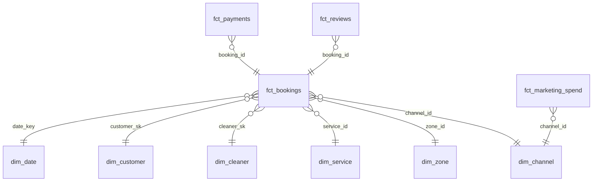

# Ucleany BI platform: from SQL Server reporting to a Databricks lakehouse

[](https://github.com/xhu96/wwi-lakehouse-migration/actions/workflows/ci.yml)

Ucleany is an on-demand home cleaning marketplace that launched in Rome in May 2026: households, short-let hosts and offices book vetted cleaners by the hour. Its first reports ran straight on the operational SQL Server database through four stored procedures that fed a monthly Excel pack.

This repository rebuilds the move of that reporting to a governed Databricks lakehouse, end to end: the legacy database and its reports, the CDC landing zone, Lakeflow pipelines with Unity Catalog, a star schema, a Power BI semantic model and report, access rules as code, and a reconciliation that proves every legacy number was either reproduced or deliberately corrected.

> **About the data.** Everything here runs on synthetic data from a deterministic simulation of the business ([docs/synthetic-data.md](docs/synthetic-data.md)). No company data, code or figures are included.

## Results

Every cell of every legacy report is compared with the lakehouse. A difference is only accepted when recomputing the lakehouse with the *legacy* rule reproduces the legacy number exactly, which proves the whole gap comes from a documented rule change.

| Legacy report | Cells | Match | Explained | Break |
| --- | ---: | ---: | ---: | ---: |
| `rpt.usp_MonthlyRevenueByZone` | 475 | 454 | 21 | 0 |
| `rpt.usp_BookingStatusMonthly` | 24 | 24 | 0 | 0 |
| `rpt.usp_CleanerMonthly` | 1,785 | 1,773 | 12 | 0 |
| `rpt.usp_NewCustomersMonthly` | 36 | 26 | 10 | 0 |

The three explained differences are bugs the old reports carried ([docs/migration-findings.md](docs/migration-findings.md)):

1. **Cash collected was overstated by €1,535.45 (0.38%).** The payment provider sometimes delivers a webhook twice, and the legacy query summed every row.
2. **New customers were overcounted by 8 (0.6%), so CAC looked better than it was.** People who signed up twice with a differently cased email counted as two customers, and months were cut on UTC instead of Rome time.
3. **Cleaner ratings included impossible values.** Before the July 2026 app release, ratings of 0 and 6 were accepted. They fed the average used for cleaner bonuses; the lakehouse quarantines them.

Bookings, hours, booking value and cleaner payouts match to the cent.

## Architecture

```mermaid
flowchart LR
    subgraph legacy["Legacy (SQL Server)"]
        ops[("ucleany_ops<br/>ops.* tables")]
        rpt["rpt.* stored procedures<br/>Excel pack"]
        ops --> rpt
    end

    subgraph uc["Databricks · Unity Catalog"]
        vol[/"landing.cdc volume<br/>parquet change files"/]
        bronze["bronze<br/>append-only change rows<br/>(Auto Loader)"]
        silver["silver<br/>cleaned, AUTO CDC<br/>SCD1 + SCD2 history"]
        gold["gold<br/>star schema + KPIs<br/>no personal data"]
        gov["governance<br/>grants, PII tags, masks,<br/>zone row filter"]
        recon["reconciliation<br/>results + summary"]
        vol --> bronze --> silver --> gold --> recon
        gov -. policy.yml .-> silver
        gov -. policy.yml .-> gold
    end

    ops -- "CDC extract" --> vol
    rpt -- "report baseline (CSV)" --> recon
    gold --> pbi["Power BI<br/>semantic model (TMDL)<br/>+ report"]
    gov -- "zone access (RLS)" --> pbi
```

One job (`ucleany_lakehouse_job`) runs the whole flow: create the Unity Catalog objects, land the extract, refresh the Lakeflow pipeline, apply the access policy, reconcile. The job fails if the reconciliation finds a single break.

## Data model



| Table | Grain | Notes |
| --- | --- | --- |
| `fct_bookings` | one booking | GMV, platform revenue, payout, lead time, first-booking flag |
| `fct_payments` | one payment record | `is_duplicate` and `counts_as_cash` for webhook retries |
| `fct_reviews` | one valid review | invalid ratings live in `silver.reviews_quarantine` |
| `dim_customer`, `dim_cleaner` | one version (SCD2) | facts join the version valid when the job started |
| `agg_kpi_monthly` | month | GMV, take rate, CAC, active customers and cleaners, rating |
| `agg_cleaner_monthly` | cleaner × month | hours against offered capacity (utilisation) |
| `agg_customer_cohorts` | cohort × month | retention matrix |

Metric definitions are in [docs/data-model.md](docs/data-model.md).

## Power BI

The semantic model is a Power BI Project in TMDL ([powerbi/](powerbi/README.md)): 15 tables, 35 documented measures that match the gold KPI definitions, a time intelligence calculation group, and dynamic row-level security for zone managers. Four report pages cover the business review, customers and marketing, cleaners and quality, and the legacy bugs the migration fixed.

CI loads the model with the Analysis Services object model and enforces the modelling rules: descriptions and format strings on every measure, `DIVIDE` instead of `/`, hidden keys, no bidirectional relationships, fixed decimal for money, and no reference in DAX or in a report visual to a field that does not exist.

## Governance

One file, [governance/policy.yml](governance/policy.yml), defines who sees what ([docs/governance.md](docs/governance.md)). After every pipeline update the job turns it into Unity Catalog grants, `pii` tags on every personal column, column masks on silver (analysts see `m***@gmail.com`, customer care sees the email), and a row filter that limits zone managers to their zones. Grants made by hand outside the policy are revoked on the next run. The Power BI roles read the same zone assignments, so SQL users and report users see the same rows.

## Engineering choices

- **Lakeflow declarative pipelines with AUTO CDC** instead of hand-written MERGE notebooks: ordering, late data and deletes are handled by the platform. ([ADR 0001](docs/adr/0001-lakeflow-declarative-pipelines.md))
- **History where the business needs it.** Customers and cleaners are SCD type 2, because payouts depend on the cleaner's level *at the time of the job*. ([ADR 0002](docs/adr/0002-scd2-for-customers-and-cleaners.md))
- **One set of SQL models, two engines.** Gold is plain SQL files rendered for Unity Catalog in the pipeline and for local Spark in CI, so every pull request builds the full lakehouse and reconciles it without a workspace. ([ADR 0003](docs/adr/0003-shared-sql-models.md))
- **Reconciliation is a gate, not a spreadsheet.** It runs in CI and in the production job, and a break fails both. ([ADR 0004](docs/adr/0004-reconciliation-as-a-gate.md))
- **No personal data in gold.** Names, emails and phones stay in silver; gold is safe to open to every analyst and to Power BI. ([ADR 0005](docs/adr/0005-no-personal-data-in-gold.md))
- **Access as code.** Grants, tags, masks and row filters come from one reviewed policy file, and identity matching runs on an email hash so masks never change pipeline results. ([ADR 0006](docs/adr/0006-governance-as-code.md))
- **One semantic model, as code.** Every metric is a documented DAX measure in a shared PBIP/TMDL model, checked in CI. ([ADR 0007](docs/adr/0007-power-bi-semantic-model-as-code.md))
- **Data quality rules as code.** Expectations that would mean a broken extract stop the pipeline; softer rules are counted and visible in the pipeline UI.

## Run it

### Locally (Python 3.10+, Java 17)

```bash
pip install -e ".[dev]"
ucleany generate --out data/landing                   # CDC landing zone, parquet
ucleany local-run --landing data/landing \
    --snapshots legacy/report_snapshots \
    --report data/reconciliation.md                   # bronze -> silver -> gold -> reconcile
pytest                                                # 46 tests, includes the end-to-end run
```

### The legacy baseline (Docker)

```bash
docker run -d --name mssql -e ACCEPT_EULA=Y -e MSSQL_SA_PASSWORD='<password>' -p 1433:1433 \
    mcr.microsoft.com/mssql/server:2022-latest
pip install -e ".[legacy]"
MSSQL_SA_PASSWORD='<password>' ucleany legacy --snapshots legacy/report_snapshots
```

This builds `ucleany_ops`, loads it, runs the four `rpt.*` procedures and exports their output. CI does the same against a SQL Server service container and fails if the result differs from the committed baseline.

### The semantic model check (.NET 8)

```bash
dotnet run --project tools/model-check -- powerbi/Ucleany.SemanticModel/definition \
    --report powerbi/Ucleany.Report/definition
```

To open the model in Power BI Desktop and connect it to your workspace, see [powerbi/README.md](powerbi/README.md).

### On Databricks (Free Edition works)

```bash
databricks auth login --host https://<your-workspace>.cloud.databricks.com
databricks bundle deploy -t dev
databricks bundle run ucleany_lakehouse_job -t dev
```

The job creates the `ucleany_dev` catalog. If your workspace does not let you create catalogs, deploy into an existing one with `--var catalog=<name>`. In dev, grants to groups that do not exist in the workspace are skipped with a warning; in prod they fail the job. Pushing to `main` deploys the `prod` target when the `DATABRICKS_HOST` and `DATABRICKS_TOKEN` repository secrets are set.

## Repository layout

```
legacy/sqlserver/        legacy schema and rpt.* stored procedures (T-SQL)
legacy/report_snapshots/ legacy report output: the reconciliation baseline
src/ucleany/synth/       business simulation and CDC landing writer
src/ucleany/transforms/  cleansing rules and the CDC table registry
src/ucleany/sql/         silver, gold and reconciliation SQL models
src/pipelines/           Lakeflow pipeline definitions (bronze, silver, gold)
src/jobs/                job tasks: Unity Catalog setup, landing, governance, reconciliation
resources/               bundle resources: pipeline and job
governance/policy.yml    access policy: grants, PII classification, masks, zone row filter
powerbi/                 Power BI Project: semantic model (TMDL) and report (PBIR)
tools/model-check/       .NET tool that loads the model with TOM and enforces modelling rules
tests/                   unit tests and the end-to-end local run
docs/                    findings, data model, governance, ADRs
```

## Roadmap

- Performance study at projected 12- and 24-month volumes (`--scale`), and the import vs DirectQuery decision it informs
- Production identity: run the job and the Power BI refresh as service principals, and publish the model with a deployment pipeline
- Milan launch: the generator already supports a second city (`milan_launch`); the model and policy need a city manager role
